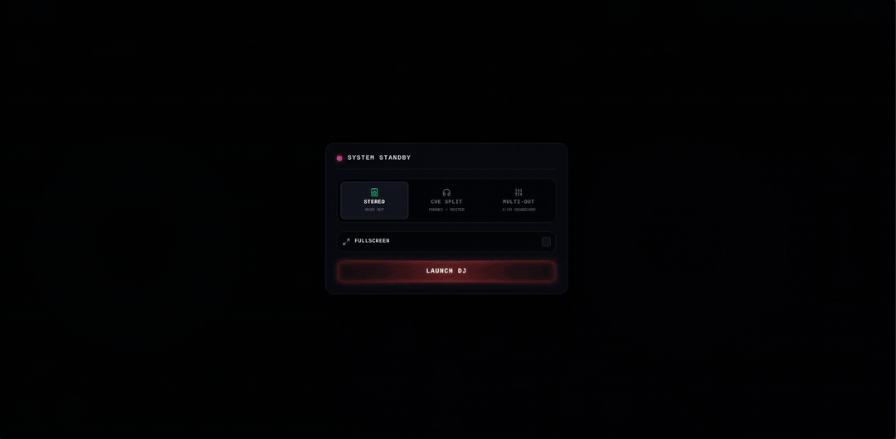
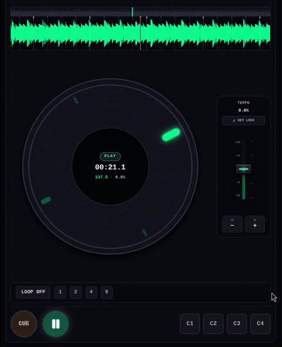
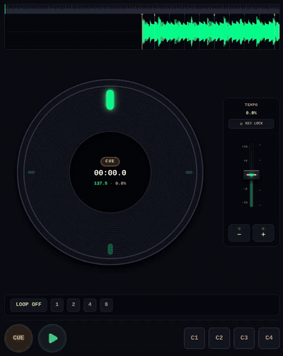
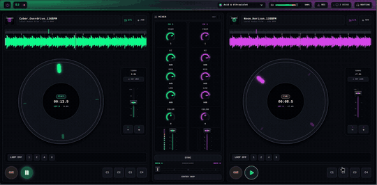
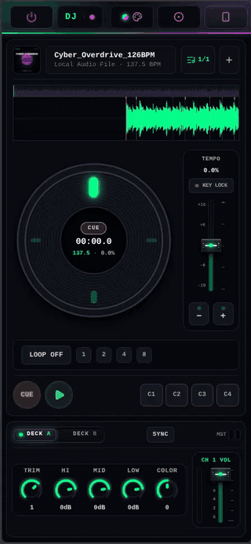

<div align="center">

# DJ

### Professional Dual-Deck Web Audio Console & Mixing Workstation

<p align="center">
  A club-grade dual-deck DJ console inspired by industry-standard hardware, built with pure Web Audio API, React 19, and TypeScript.
</p>

<!-- CONSISTENT UNIFIED BADGES (Flat-square, matte dark neutral palette) -->
<p align="center">
  
  
  
  
  
  
</p>

<br />

<!-- MAIN CONSOLE PREVIEW HERO (LIVE DUAL-DECK DEMO) -->
<table border="0" width="100%">
  <tr>
    <td align="center">
      <a href="./docs/assets/console-hero.gif">
        
      </a>
      <p align="center">
        <sub>Dual-deck live workstation in action: spectral waveform scrolling, real-time vinyl jogwheel rotation, 3-band isolators, and responsive controls.</sub>
      </p>
    </td>
  </tr>
</table>

</div>

---

## Overview

**DJ** brings the tactile response and acoustic precision of professional club hardware directly into the web browser. Built on raw Web Audio API nodes with zero heavy audio libraries, it features low-latency forward and reverse audio buffers, mechanical platter inertia, isolator equalizers, and multi-channel cue routing.

- **Mechanical Platter Inertia**: Natural momentum, slipmat friction drag, and bidirectional vinyl scratching.
- **Motorized Calibration Sequence**: Authentic hardware power routine where faders park and knobs settle to physical detents.
- **Digital Instant-On LEDs**: Clean, responsive illumination without sluggish warm-up delays.
- **Flexible Cue Routing**: Split-stereo headphone previewing (Left = Master, Right = Cue) or discrete multi-channel audio card output.
- **Universal Artwork & Metadata**: Built-in parser reading ID3v2 APIC cover art from RIFF WAV files, MP3, FLAC, and M4A.

---

## Interface & Modules

<div align="center">

<table width="100%" border="0" cellpadding="8">
  <tr>
    <td width="50%" align="center" valign="top">
      <h4>Turntable & Scratch Engine</h4>
      <a href="./docs/assets/jogwheel-scratch.gif">
        
      </a>
      <p align="left">
        <sub>Dual PCM buffers for forward playback and instant reverse scrubbing. Platter inertia model simulates slipmat mass and coasting dynamics even when empty.</sub>
      </p>
    </td>
    <td width="50%" align="center" valign="top">
      <h4>Interactive Waveforms</h4>
      <a href="./docs/assets/waveform-scrub.gif">
        
      </a>
      <p align="left">
        <sub>Multi-band spectral visualization with interactive playhead scrubbing, dynamic beat-grid subdivisions, and cue point markers.</sub>
      </p>
    </td>
  </tr>
  <tr>
    <td colspan="2" align="center" valign="top">
      <h4>Mixer & Channel Strips</h4>
      <a href="./docs/assets/mixer-controls.gif">
        
      </a>
      <p align="left">
        <sub>3-band isolator frequency cuts (-∞ kill to +6dB), bi-directional sound color filter with center detent, and horizontal crossfader with 0.0 center snap.</sub>
      </p>
    </td>
  </tr>
  <tr>
    <td colspan="2" align="center" valign="top">
      <h4>Single-Deck Layer View</h4>
      <a href="./docs/assets/mobile-deck.gif">
        
      </a>
      <p align="center" style="max-width: 420px; margin: 8px auto 0 auto;">
        <sub>Compact layout for touchscreens and smaller displays with dedicated hardware layer toggling between Deck A and Deck B.</sub>
      </p>
    </td>
  </tr>
</table>

</div>

---

## Technical Specifications

| Parameter | Specification |
| :--- | :--- |
| **Audio Processing** | 32-bit floating-point Web Audio API graph |
| **Scratch Mechanics** | Dual forward/reverse audio buffers with angular deceleration model |
| **Isolator EQ Bands** | Low: < 300 Hz (Kill) &bull; Mid: 300 Hz – 3 kHz &bull; High: > 3 kHz (+6 dB boost) |
| **Color Filter** | Resonant 2-pole bi-quad sweep (LPF / HPF) with center pass-through |
| **Crossfader** | Linear dual-rail slider with center detent snap (`0.0`) |
| **Performance Pads** | 4 Hot Cues per deck with real-time capture and recall |
| **Supported File Formats** | WAV (including RIFF `id3 ` chunks), MP3 (ID3v2.3/v2.4), FLAC, M4A, OGG, AAC |
| **Monitoring Modes** | Split-Stereo (L = Master, R = Cue) and Multi-Channel Device Routing |
| **Master Recording** | Live 32-bit mixdown recorder with direct file export |

---

## Performance Keyboard Shortcuts

<div align="center">

| Function | Deck A | Deck B | Action |
| :--- | :---: | :---: | :--- |
| **Play / Pause** | <kbd>F</kbd> | <kbd>J</kbd> | Tap to toggle playback; hold for platter brake |
| **Scratch Reverse** | <kbd>F</kbd> + <kbd>←</kbd> / <kbd>↓</kbd> | <kbd>J</kbd> + <kbd>←</kbd> / <kbd>↓</kbd> | Rapid reverse vinyl scrub with coasting inertia |
| **Scratch Forward** | <kbd>F</kbd> + <kbd>→</kbd> / <kbd>↑</kbd> | <kbd>J</kbd> + <kbd>→</kbd> / <kbd>↑</kbd> | Forward vinyl scratch push |
| **Pitch Bend (- / +)** | <kbd>F</kbd> + <kbd>-</kbd> / <kbd>+</kbd> | <kbd>J</kbd> + <kbd>-</kbd> / <kbd>+</kbd> | Micro-nudge tempo to align phase |
| **Memory Cue** | <kbd>D</kbd> | <kbd>K</kbd> | Set track return zero-point |
| **Audition Cue** | <kbd>G</kbd> | <kbd>H</kbd> | Play cue point while pressed |
| **Set Hot Cue (1–4)** | <kbd>T</kbd> + <kbd>1–4</kbd> | <kbd>U</kbd> + <kbd>1–4</kbd> | Save hot cue marker at current playhead |
| **Trigger Hot Cue (1–4)** | <kbd>V</kbd> + <kbd>1–4</kbd> | <kbd>N</kbd> + <kbd>1–4</kbd> | Instant jump to hot cue position |
| **Track Browser** | <kbd>R</kbd> | <kbd>I</kbd> | Open track library dialog |
| **Exit / Close** | <kbd>Escape</kbd> | <kbd>Escape</kbd> | Close configuration dialogs or exit fullscreen |

</div>

---

## Signal Flow

```
                      ┌──────────────────────────────────────┐
                      │             Audio Input              │
                      │   WAV (with ID3) / MP3 / FLAC / M4A  │
                      └──────────────────┬───────────────────┘
                                         │
                    ┌────────────────────┴────────────────────┐
                    ▼                                         ▼
         ┌─────────────────────┐                   ┌─────────────────────┐
         │       Deck A        │                   │       Deck B        │
         │  • Forward Buffer   │                   │  • Forward Buffer   │
         │  • Reverse Buffer   │                   │  • Reverse Buffer   │
         │  • Platter Inertia  │                   │  • Platter Inertia  │
         │  • Pitch / Keylock  │                   │  • Pitch / Keylock  │
         └──────────┬──────────┘                   └──────────┬──────────┘
                    │                                         │
                    ▼                                         ▼
         ┌─────────────────────┐                   ┌─────────────────────┐
         │     Channel EQ      │                   │     Channel EQ      │
         │  • 3-Band Isolator  │                   │  • 3-Band Isolator  │
         │  • Sound Color      │                   │  • Sound Color      │
         │  • Channel Fader    │                   │  • Channel Fader    │
         └──────────┬──────────┘                   └──────────┬──────────┘
                    │                                         │
                    └────────────────────┬────────────────────┘
                                         │
                                         ▼
                            ┌─────────────────────────┐
                            │   Hardware Crossfader   │
                            │   (Center Detent Snap)  │
                            └────────────┬────────────┘
                                         │
                    ┌────────────────────┴────────────────────┐
                    ▼                                         ▼
         ┌─────────────────────┐                   ┌─────────────────────┐
         │     Master Out      │                   │    Headphone Cue    │
         │  • Level Trim       │                   │  • Pre-Fader Listen │
         │  • 32-bit Recorder  │                   │  • Split-Stereo Bus │
         │  • Safety Limiter   │                   │  • Headphone Out    │
         └──────────┬──────────┘                   └──────────┬──────────┘
                    │                                         │
                    ▼                                         ▼
             [Master Output]                            [Headphones]
```

---

## Getting Started

### Prerequisites
- **Node.js**: `v18.0.0` or higher
- **npm**, **pnpm**, or **yarn**

### Installation

1. Clone the repository:
   ```bash
   git clone https://github.com/<your-username>/DJ.git
   cd DJ
   ```

2. Install dependencies:
   ```bash
   npm install
   ```

3. Start the local development server:
   ```bash
   npm run dev
   ```
   Open `http://localhost:5173` in your browser.

4. Build for production:
   ```bash
   npm run build
   npm run preview
   ```

---

## Project Structure

```
dj-console/
├── docs/
│   └── assets/                     # Media assets, screenshots, and demonstration GIFs
│       ├── console-hero.gif        # Full console live demonstration
│       ├── jogwheel-scratch.gif    # Jogwheel scratch and inertia demonstration
│       ├── mixer-controls.gif      # Mixer EQ and crossfader demonstration
│       ├── waveform-scrub.gif      # Waveform scrubbing and hot cue demonstration
│       └── mobile-deck.gif         # Single-deck compact layer demonstration
├── src/
│   ├── components/
│   │   ├── DJDeck.tsx              # Deck container with jogwheel, fader, and pads
│   │   ├── DJJogwheel.tsx          # Turntable jogwheel with physics and LED encoder
│   │   ├── DJMixerSection.tsx      # Central mixer with 3-band EQs and crossfader
│   │   ├── DJHardwareFader.tsx     # Hardware-grade motorized vertical and cross faders
│   │   ├── Knob.tsx                # Rotary knobs with LED arc level indicators
│   │   ├── DJHeader.tsx            # Master controls, recording, and power tally
│   │   ├── DJWaveform.tsx          # Real-time multi-band waveform display
│   │   ├── DeckHardwareSelector.tsx# Deck layer selector
│   │   └── AudioRoutingConfigModal.tsx # Headphone cue and output routing dialog
│   ├── dj/
│   │   ├── DJMixer.ts              # Web Audio master mixing and bus routing
│   │   ├── DeckAudio.ts            # Buffer decoding, scratch math, and platter physics
│   │   ├── metadataParser.ts       # Audio tag parser (ID3v2 APIC, WAV id3 chunk, FLAC)
│   │   ├── BPMDetector.ts          # Peak energy BPM detection
│   │   └── KeyboardController.ts   # Keyboard event handling for DJ shortcuts
│   ├── App.tsx                     # Main application layout and view modes
│   └── main.tsx                    # Application entry point
├── LICENSE                         # GNU GPL v3.0 License
└── package.json                    # Project configuration and scripts
```

---

## Media Assets

| File | Target Location | Dimensions / Aspect Ratio | Content |
| :--- | :--- | :---: | :--- |
| **Main Console** | [`docs/assets/console-hero.gif`](./docs/assets/console-hero.gif) | 1080 &times; 530 px (2.04:1) | Live dual-deck console demonstration with active waveforms and platters |
| **Turntable Scratch** | [`docs/assets/jogwheel-scratch.gif`](./docs/assets/jogwheel-scratch.gif) | 480 &times; 590 px (0.81:1) | Vinyl scratch dynamics, inertia coasting, and jogwheel rotation |
| **Waveform Scrub** | [`docs/assets/waveform-scrub.gif`](./docs/assets/waveform-scrub.gif) | 400 &times; 504 px (0.79:1) | Multi-band spectral scrolling and needle drop playhead scrubbing |
| **Mixer Controls** | [`docs/assets/mixer-controls.gif`](./docs/assets/mixer-controls.gif) | 540 &times; 266 px (2.03:1) | 3-band isolators, sound color sweep, and dual-rail crossfader transition |
| **Single Deck View** | [`docs/assets/mobile-deck.gif`](./docs/assets/mobile-deck.gif) | 340 &times; 736 px (0.46:1) | Compact mobile view with hardware deck layer switching |

---

## Privacy, Data & Legal Disclaimers

> [!NOTE]
> **Client-Side Processing & Privacy**  
> This application operates 100% locally within the client browser. No user audio files, playlists, recordings, metadata, or telemetry are ever uploaded, stored, collected, or transmitted to any external server or third party. All audio decoding and playback take place strictly in temporary volatile memory (`Web Audio API`) and are released immediately upon closing or refreshing the tab.

> [!IMPORTANT]
> **Copyright & Fair Use Notice**  
> This software is an open-source, client-side digital signal processing instrument. It is provided empty and does not distribute, host, stream, generate, or bundle any copyrighted audio recordings or musical compositions. Users are solely responsible for ensuring they possess the appropriate legal rights, licenses, and permissions for any personal audio files loaded into the interface for personal playback and mixing.

> [!TIP]
> **Trademark Notice**  
> All product names, logos, brands, trademarks, and registered trademarks referenced or depicted are property of their respective owners. Any reference to hardware design conventions is solely for technical descriptor and compatibility identification purposes and does not imply any affiliation, sponsorship, endorsement, or certification by any hardware manufacturer or brand.

---

## License

This project is open-source software licensed under the [GNU General Public License v3.0 (GPLv3)](./LICENSE).
